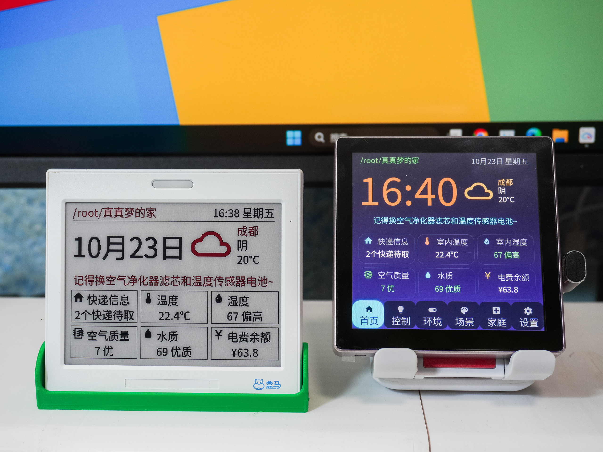

# ESP32-4848S040 智能家庭控制面板 · ESPHome中文5屏 带4.2寸墨水屏推送 真真梦2026



基于 **ESP32-S3 N16R8（ESP32-4848S040，4.0 寸 480×480 IPS + GT911 触摸 + 一路继电器）** 的智能家庭控制面板固件工程。带蓝牙墨水屏推送家庭信息功能。详见说明文件。
方案：**ESPHome + Home Assistant**，原生集成；界面为 **LVGL 中文 5 屏**（首页 / 灯光 / 开关 / 场景 / 设置），中文字体从第一版即嵌入。
设置页工作台用不到可自行删除。

---

## 一、目录结构

```
esp32-panel/
├── esp32-panel.yaml          # 主配置：板级外设 + 中文字体 + LVGL 5 屏 UI + 继电器
├── partitions.csv            # 自定义分区表（app 分区 6MB，容纳中文字库，支持 OTA）
├── secrets.yaml              # ← 先复制模板并填写密钥/WiFi
├── st7701_full_init.yaml     # 屏幕完整初始化序列备用（屏幕不亮时替换用）
├── fonts/
│   ├── NotoSansCJKsc-Regular.otf   # 思源黑体（中文字体源）
│   ├── materialdesignicons-webfont.ttf  # MDI 图标字体
│   ├── materialdesignicons.css     # MDI 码点表（仅供生成脚本使用）
│   ├── zh_glyphs.yaml              # 中文子集：3755 常用汉字 + 全角标点 + ASCII
│   └── mdi_glyphs.yaml             # 面板用到的 MDI 图标子集
└── scripts/
    ├── gen_zh_glyphs.py       # 重新生成中文字符子集（换字体/加字时用）
    ├── st7701_parse.py        # 从厂商库提取 ST7701 完整初始化序列
    ├── apply_mdi.py           # 图标占位符 <mdi:xxx> → 真实字符（改图标后跑一次）
    └── check_yaml.py          # 配置完整性检查
```

## 二、运行环境（本机已就绪）

- **Python**：3.10 及以上（本机已装 **3.13.13**，`python --version` 可查）
- **pip**：已可用（`python -m pip --version`）

### 安装 ESPHome（推荐 venv，不动系统环境）

```powershell
cd 本文件夹目录
python -m venv .venv
.\.venv\Scripts\Activate.ps1        # 激活虚拟环境
python -m pip install --upgrade pip
python -m pip install esphome       # 安装最新版（已实测 ESPHome 2026.9.1 通过本配置校验）
esphome version
```

> 本机如无网络或想离线安装：在能联网的机器执行
> `python -m pip download esphome -d esphome_wheels`，再把 `esphome_wheels` 拷到本机，
> 执行 `python -m pip install --no-index --find-links=esphome_wheels esphome`。
> 编译工具链（platformio + ESP-IDF）首次编译时自动下载，约 2~3GB，需联网一次。

## 三、配置（3 步）

1. **填写密钥**：复制 `secrets.yaml` 为真实文件（本包内已是模板，直接编辑即可），填写 WiFi、API 密钥、OTA 密码。
   API 密钥生成：`python -c "import secrets,base64;print(base64.b64encode(secrets.token_bytes(32)).decode())"`
2. **改设备名与继电器名**：编辑 `esp32-panel.yaml` 顶部 `substitutions`：
   - `name`：设备名（小写字母/数字/下划线）
   - `relay_name`：继电器控制的灯的名字（如 `客厅灯L` / `卧室灯L`），改完后 HA 里自动出现同名实体
   - **命名规则（重要）**：ESPHome 要求实体名含**至少一个 ASCII 字母/数字**（中文会转成下划线，全中文的名字之间会互相冲突导致编译报错）。默认已带 `L`（Light 灯），你自己改名时务必保留一个 ASCII 字符，如 `客厅灯L`、`门厅灯L`。
3. **（可选）固定 IP**：取消 `wifi.manual_ip` 注释并填写。

## 四、校验 / 编译 / 烧录

> 状态：本配置已通过 **ESPHome 2026.9.1** 的 `esphome config` 校验（仅剩 GPIO19/45/20 的常规警告与 ota password 提示，均不影响使用）。

```powershell
# 1. 语法校验（不编译，快速发现配置错误）
esphome config esp32-panel.yaml

# 2. 编译 + 烧录（USB 线连接板子，按住 BOOT 或按提示进入下载模式）
esphome run esp32-panel.yaml

# 3. 之后 OTA 无线升级
esphome upload esp32-panel.yaml

# 4. 查看日志
esphome logs esp32-panel.yaml
```

首次编译会下载 ESP-IDF 工具链（2~3GB），耗时 10~30 分钟，属正常现象；后续编译很快。

## 五、Home Assistant 接入

- 面板首次开机连上 WiFi 后，HA 会自动发现 `esp32-panel`（原生 ESPHome 集成）。
- 若未自动发现：HA → 设置 → 设备与服务 → 添加集成 → **ESPHome** → 填面板 IP 与 API 密钥。
- 接入后自动出现的实体：
  - `light.客厅灯L`（继电器控制的灯，可用 HA 自动化联动；实际 entity_id 为 ASCII 化后的名字）
  - `light.背光BL`（背光亮度）
  - `sensor.温度T` / `sensor.湿度%RH`（板载 SHT20，若无该传感器则为空）
  - `sensor.WiFi信号` / `text.IP地址` 等

## 六、主页扩展数据配置（空气质量 / 水质 / 电费 / 包裹 / 通知）

主页 6 卡中，温度/湿度来自板载 SHT20；**空气/水质/电费/包裹 + 通知栏**订阅 HA 中间实体（默认
`sensor.panel_air` / `sensor.panel_water` / `sensor.panel_elec` / `sensor.panel_package` / `sensor.panel_notice`）。
**面板编译一次即可，以后换数据源只在 HA 里改模板，不用重刷面板。**

在 HA 的 `configuration.yaml` 里加（或 HA → 设置 → 设备与服务 → 模板，粘贴）：把 `states('...')` 里的实体换成你自己的：

```yaml
template:
  - sensor:
      - name: "Panel Temp"
        unique_id: panel_temp
        state: "{{ states('sensor.你的温度实体') }}"
        unit_of_measurement: "°C"
      - name: "Panel Hum"
        unique_id: panel_hum
        state: "{{ states('sensor.你的湿度实体') }}"
        unit_of_measurement: "%"
      - name: "Panel Air"
        unique_id: panel_air
        state: "{{ states('sensor.你的空气质量实体') }}"
        unit_of_measurement: "μg/m³"
      - name: "Panel Water"
        unique_id: panel_water
        state: "{{ states('sensor.你的水质实体') }}"
        unit_of_measurement: "mg/L"
      - name: "Panel Elec"
        unique_id: panel_elec
        state: "{{ states('sensor.你的电费余额实体') }}"
        unit_of_measurement: "元"
      - name: "Panel Package"
        unique_id: panel_package
        state: "{{ states('sensor.你的快递实体') }}"
  - text:
      - name: "Panel Notice"
        unique_id: panel_notice
        state: "{{ states('input_text.panel_notice', '无新通知') }}"
```

> 中间实体名字用英文（Panel Air → `sensor.panel_air`），保证实体 ID 与面板订阅一致；中文名会被转义导致 ID 对不上。
> 通知栏：配合一个 `input_text.panel_notice` 辅助开关（HA 设置 → 辅助元素 → 添加 → 文本框），随时在 HA 里改通知内容。
> 面板主页显示逻辑：数值卡显示 `--` 表示 HA 实体未接；通知栏显示"无新通知"。

## 七、中文框架说明（重点）

- **字体方案**：思源黑体（Noto Sans CJK SC）→ LVGL 子集字体，含 **3755 个 GB2312 一级常用汉字 + 常用全角标点 + ASCII**，覆盖智能面板全部文案。字号：主标题 28px、正文 20px、首页时钟 48px（数字专用小字库，几乎不占空间）。
- **图标**：Material Design Icons（与厂商原版同风格），`scripts/gen_zh_glyphs.py` 从 `fonts/materialdesignicons.css` 解析码点生成 `fonts/mdi_glyphs.yaml`；加图标改脚本内 `wanted` 列表后重跑。
- **换字体 / 加字**：把新字体放进 `fonts/`，改 `esp32-panel.yaml` 中 `font:` 段的 `file:` 路径；若用了子集外的字，运行
  `python scripts/gen_zh_glyphs.py` 重新生成 `fonts/zh_glyphs.yaml`（脚本自动从 GB2312 一级字库 + 补充符号生成）。
- **UI 结构**：`lvgl.pages` 下 5 个页面，全部中文文案；底部导航栏切换页面；时间/日期/温湿度/信号由 `time.on_time` 与 `interval` 每秒/每 5 秒刷新。
- **深色科技风**：渐变背景由 `scripts/gen_bg.py` 预渲染（2D Floyd-Steinberg 抖动，消除 RGB565 横条）；发光卡片用 `drop_shadow_*`（仅对不透明背景对象可见）；当前页导航为青色高亮胶囊。
- **家庭名**：改 `esp32-panel.yaml` 顶部 `substitutions.home_name`（如"温馨之家"）。

## 八、常见问题排查

| 现象 | 原因 / 处理 |
|---|---|
| `esphome` 命令找不到 | 未激活 venv：先执行 `.\.venv\Scripts\Activate.ps1` |
| 编译报 `Config value 'xxx' is invalid` | 常见于 LVGL 组件版本差异，把 `esphome` 升级到最新：`python -m pip install -U esphome` |
| 烧录失败 `Failed to connect` | 检查 USB 驱动（ESP32-S3 用原生 USB，无需 CP210x 驱动）；按住 BOOT 再插线；换数据线（要支持数据传输的线） |
| 屏幕不亮 / 花屏 | 用 `st7701_full_init.yaml` 的内容整段替换 `esp32-panel.yaml` 中 `display.init_sequence` |
| 继电器方向反了（灯常亮/反向） | `output` 段的 `relay_out` 加一行 `inverted: true` |
| 首页温湿度显示 `--` | 板上无 SHT20 或传感器异常，删除 `sensor` 段中 `htu21d` 部分即可 |
| 主页扩展卡显示 `--` | HA 中间实体未建或未接：按第六节模板建 `sensor.panel_*` 并把 `states('...')` 指向真实实体 |
| 连不上 WiFi | 2.4GHz 才行（ESP32 不支持 5G）；面板会自动开 `esp32-panel-fallback` 热点 |
| 界面某字显示空白/方块 | 该字不在 `zh_glyphs.yaml` 子集内，重跑 `gen_zh_glyphs.py` 或手动把字加进子集 |
| 编译提示 Flash 空间不足 | 检查 `partitions.csv` 是否在工程目录（`board_build.partitions: partitions.csv` 已配置） |

## 九、待扩展

- **开关页 / 场景页**：目前为占位按钮，`esp32-panel.yaml` 中对应按钮的 `on_click` 可改成
  `light.toggle: <实体id>` 或 `homeassistant.service: service: script.turn_on data: {entity_id: script.xxx}` 绑定 HA 自动化。
- **米家设备联动**：面板本身无法直连米家（生态封闭）。推荐 HA 装 `Xiaomi Miot Auto` / `Xiaomi Gateway 3` 集成，米家设备进 HA 后，面板实体与 HA 自动化即可联动控制。
- 继电器的第二、三路（relay2/relay3）接线方式见官方原理图（`esp32-4848S040_official\5-IO pin distribution`）。
